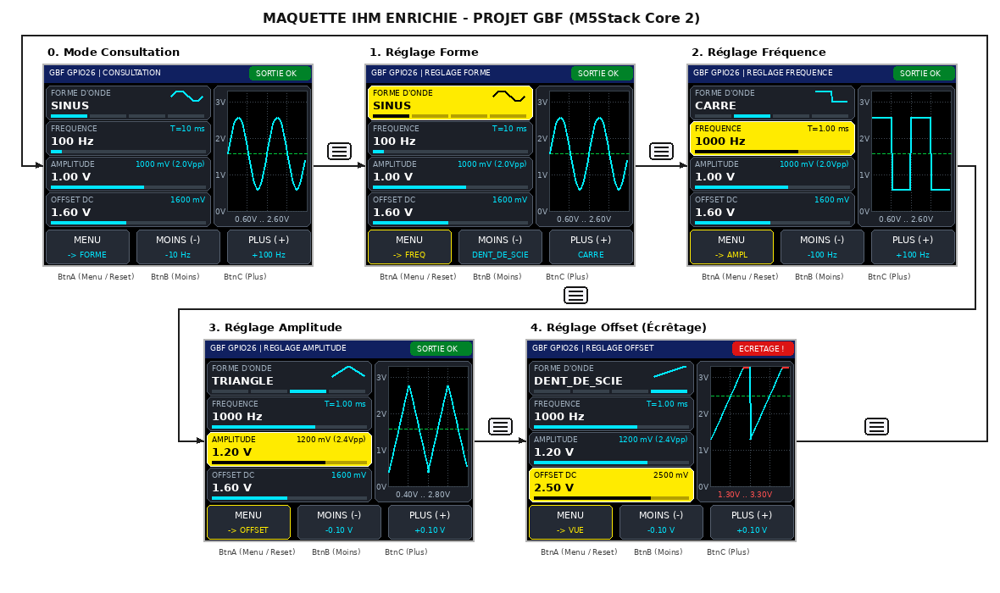
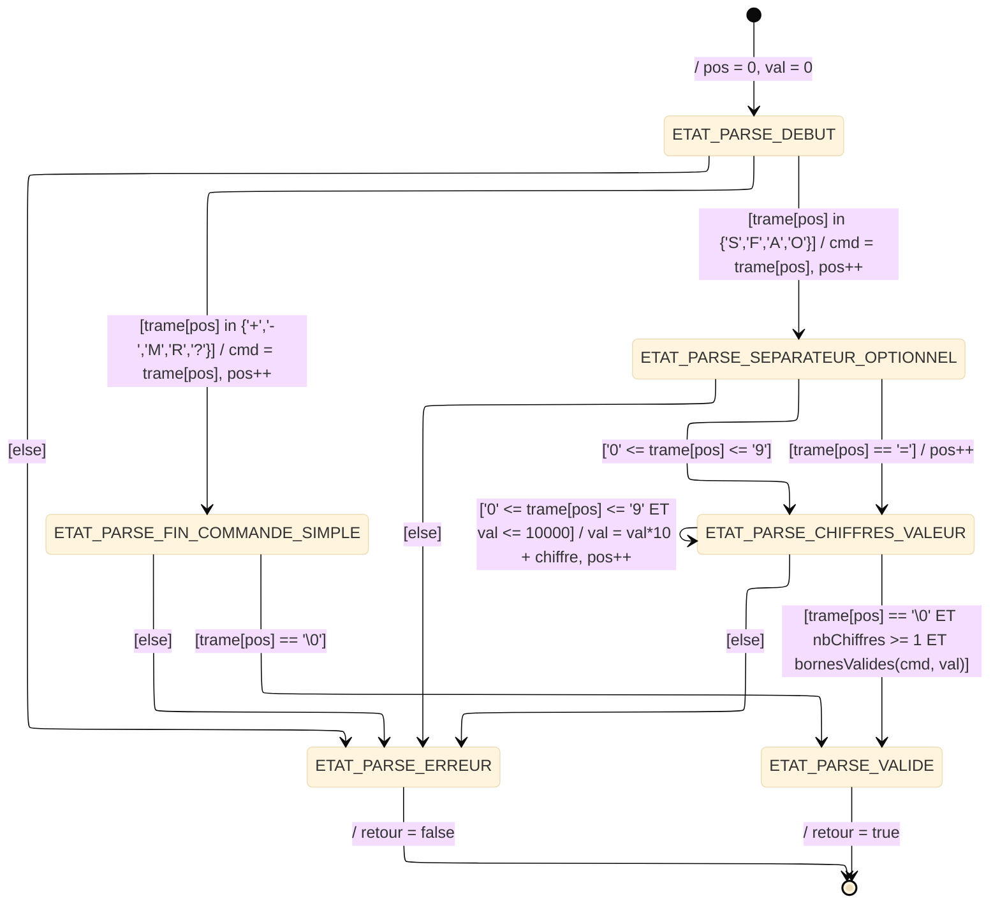
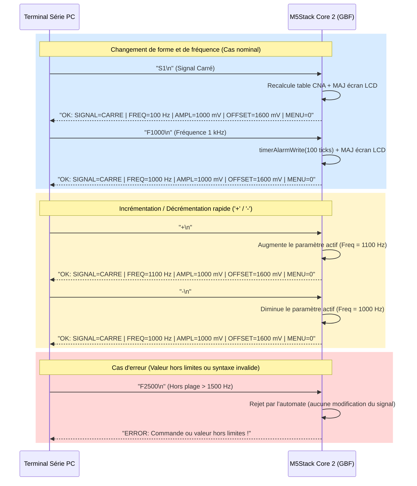
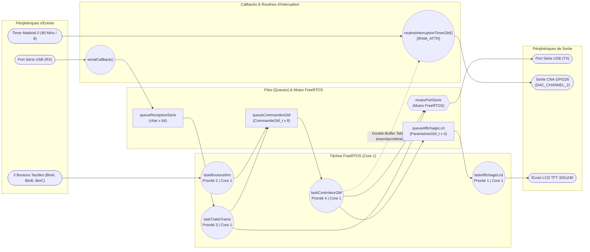

# Projet GBF Temps Réel sur M5Stack Core 2 (FreeRTOS)

**Ressource R5.10 : Systèmes Embarqués — Module INFO5 (BUT GEII Semestre 5)**  
**Exercice 14 : Réalisation d'un Générateur Basses Fréquences (GBF)**

---

## 1. Présentation et Architecture du Projet

Ce projet implémente un **Générateur Basses Fréquences (GBF)** complet sur cible **M5Stack Core 2 (ESP32)** en **C++ (Arduino / ESP-IDF)** sous le système d'exploitation temps réel **FreeRTOS**.

### Caractéristiques techniques
- **Sortie analogique** : Broche **GPIO26** (`DAC_CHANNEL_2` sur le connecteur Grove Port B, résolution 8 bits : $0\text{ V}$ à $3{,}3\text{ V}$).
- **Formes d'ondes synthétisées** : **Sinus**, **Carré**, **Triangle** et **Dent de scie** ($100$ échantillons par période).
- **Plage de fréquence** : Réglable de **$1\text{ Hz}$ à $1\,500\text{ Hz}$** ($1{,}5\text{ kHz}$), cadencée par le **Timer matériel 0** en interruption (`IRAM_ATTR`) avec double-buffering sans coupure du signal.
- **Amplitude crête réglable** : De **$100\text{ mV}$ ($0{,}10\text{ V}$) à $1\,600\text{ mV}$ ($1{,}60\text{ V}$)** par pas de $100\text{ mV}$ (soit jusqu'à $3{,}20\text{ V}_{\text{càc}}$).
- **Offset réglable** : De **$0\text{ mV}$ ($0{,}00\text{ V}$) à $3\,300\text{ mV}$ ($3{,}30\text{ V}$)** par pas de $100\text{ mV}$, avec écrêtage numérique automatique dans la plage $[0\text{ mV} \,;\, 3\,300\text{ mV}]$ du CNA.
- **Double interface de commande** :
  1. **Locale** : Via les **3 boutons tactiles capacitifs** (`BtnA` Menu / Reset, `BtnB` Moins, `BtnC` Plus), le **toucher direct des cartes sur l'écran tactile** avec retour haptique (vibreur) et un affichage double-bufferisé (`M5Canvas`) sur l'écran LCD $320 \times 240$ incluant 4 cartes à jauges, un **oscilloscope 2 périodes avec alerte d'écrêtage** et des touches logicielles contextuelles.
  2. **Distante** : Via le **port série USB ($115\,200\text{ bauds}$)** par fonction de callback (`Serial.onReceive`), décodage par automate à états finis et **réponse de confirmation** protégée par **Mutex FreeRTOS**.

### Organisation modulaire des fichiers (Charte §4)

```text
m5core2_gbf/
├── platformio.ini                   # Configuration PlatformIO (M5Stack Core 2, M5Unified, 115200 bauds)
├── readme.md                        # Documentation complète (IHM, Diagrammes, Protocole, Tests)
├── docs/
│   └── maquette_ihm.png             # Visuel de la maquette IHM enrichie (5 écrans et transitions)
├── lib/
│   ├── GbfConfig/
│   │   └── GbfConfig.h              # Constantes MAJUSCULES, énumérations et structures FreeRTOS
│   ├── GbfSignal/
│   │   ├── GbfSignal.h              # Interface de synthèse numérique, CNA (GPIO26) et Timer 0
│   │   └── GbfSignal.cpp            # Implémentation des tables d'ondes et de l'ISR Timer en IRAM
│   ├── GbfIhm/
│   │   ├── GbfMiseEnPage.h          # Coordonnées géométriques partagées (rendu LCD & détection tactile)
│   │   ├── GbfIhm.h                 # Interface de la logique IHM pure (testable sur PC sans matériel)
│   │   └── GbfIhm.cpp               # Machine à états IHM, détection d'écrêtage, période, libellés
│   ├── GbfAffichage/
│   │   ├── icons.h                  # Icônes XBM 64x50 de référence
│   │   ├── GbfAffichage.h           # Palette RGB565, polices et interface de rendu par sprite M5Canvas
│   │   └── GbfAffichage.cpp         # Rendu double-bufferisé (bandeau, 4 cartes, oscillo, touches)
│   ├── GbfSerie/
│   │   ├── GbfSerie.h               # Interface du protocole série et de l'automate décodeur
│   │   └── GbfSerie.cpp             # Décodage de trames sans Regex et envoi protégé par Mutex
│   └── GbfTests/
│       ├── GbfTests.h               # Interface des tests unitaires embarqués
│       └── GbfTests.cpp             # Suite de tests unitaires (cas nominaux, limites et erreurs)
└── src/
    └── main.cpp                     # Initialisation et lancement des 4 tâches FreeRTOS
```

### Conformité à la Charte de Qualité du Code
1. **Nommage des variables (§1)** : Notation `camelCase` commençant par une minuscule de manière constante dans tout le projet (`frequenceHz`, `amplitudeMv`, `offsetMv`, `formeSignal`, `etatCourant`, `queueCommandesGbf`). Aucun accent ni caractère spécial.
2. **Absence de variables globales applicatives (§1.1)** : L'état du GBF (`ParametresGbf_t`) est une variable locale appartenant exclusivement à la tâche `taskControleurGbf`, et le sprite plein écran `M5Canvas` est une variable locale à `taskAffichageLcd`. Les handles FreeRTOS (`QueueHandle_t`, `SemaphoreHandle_t`) sont regroupés dans une structure `ContexteRtosGbf_t` transmise aux tâches via le pointeur `pvParameters`. Seuls le double-buffer de l'ISR matérielle (`GbfSignal.cpp`) et le handle de file du callback série (`main.cpp`) ont une portée statique limitée à leur fichier (`static`), car les signatures matérielles `void IRAM_ATTR isr(void)` et `Serial.onReceive(void(*)(void))` n'acceptent aucun paramètre utilisateur.
3. **Constantes (§2)** : Toutes les valeurs numériques (bornes, pas, tailles de piles, priorités, coordonnées LCD, couleurs, diviseur Timer) sont définies par des constantes en `MAJUSCULES_AVEC_UNDERSCORES` dans `GbfConfig.h`, `GbfMiseEnPage.h` et `GbfAffichage.h`.
4. **Commentaires Doxygen (§5)** : Chaque fichier, structure, énumération et fonction possède un en-tête complet au format Javadoc/Doxygen (`@file`, `@brief`, `@param`, `@return`).
5. **Gestion des erreurs (§6)** : Vérification systématique des pointeurs `nullptr`, des retours de création FreeRTOS (`xQueueCreate`, `xSemaphoreCreateMutex`, `xTaskCreatePinnedToCore`), de l'allocation du sprite `M5Canvas`, des retours matériels (`dac_output_enable`, `timerBegin`) et saturation des valeurs numériques.

---

## 2. Maquette IHM

L'interface graphique sur l'écran TFT $320 \times 240$ est dessinée dans un **sprite plein écran (`M5Canvas`)** en mémoire PSRAM avant d'être transférée en une seule opération SPI (`pushSprite`), éliminant tout scintillement (*flickering*) :

- **Bandeau d'état supérieur** : Affiche le mode actif (`CONSULTATION`, `REGLAGE FORME`, `REGLAGE FREQUENCE`, `REGLAGE AMPLITUDE`, `REGLAGE OFFSET`) et un **badge de santé du signal** en temps réel (`SORTIE OK` en vert, ou `ECRETAGE !` en rouge dès que $\text{Offset} \pm \text{Amplitude}$ dépasse la plage $[0\text{ V} \,;\, 3{,}3\text{ V}]$ du CNA).
- **4 Cartes de paramètres interactives (colonne de gauche)** :
  - Chaque carte présente le nom du paramètre, sa **valeur principale en gras** (`FreeSansBold9pt7b`), une **information secondaire** à droite (miniature de la forme d'onde, période $T$ calculée automatiquement, tension crête-à-crête $V_{\text{pp}}$, valeur en $\text{mV}$) et une **jauge de progression** en bas de carte.
  - La carte sélectionnée passe en **surbrillance jaune (`COULEUR_SELECTION`) avec texte noir (`COULEUR_TEXTE_SELECTION`)**.
  - **Sélection tactile directe** : En plus du bouton `Menu` (`BtnA`), l'utilisateur peut toucher directement une carte sur l'écran pour la sélectionner (ou toucher la carte active / l'oscilloscope pour revenir en mode `Consultation`).
- **Oscilloscope temps réel sur 2 périodes (colonne de droite)** :
  - Grille graduée de $0\text{ V}$ à $3\text{ V}$ avec divisions temporelles en pointillés et ligne d'offset continu en tirets verts.
  - Tracé de **2 périodes complètes** de l'onde réelle : la courbe est **cyan (`COULEUR_ACCENT`)** en fonctionnement linéaire et devient automatiquement **rouge (`COULEUR_ALERTE`)** sur les crêtes écrêtées.
  - Légende inférieure affichant l'excursion réelle $[V_{\min} \,..\, V_{\max}]$ générée sur `GPIO26`.
- **Barre de 3 touches logicielles contextuelles (en bas, en face de `BtnA`, `BtnB`, `BtnC`)** :
  - Affiche en temps réel l'effet exact du prochain appui sur chaque bouton : prochain état du menu (`-> FORME`, `-> FREQ`...), pas courant d'incrémentation/décrémentation (`-10 Hz` / `+100 Hz`, `-0.10 V` / `+0.10 V`, forme précédente/suivante) ou indication de butée (`MIN` / `MAX`).



---

## 3. Diagrammes d'État

### 3.1 Diagramme d'état de l'IHM et du contrôleur GBF

Ce diagramme d'état modélise la sélection et la modification des paramètres du GBF (que les événements proviennent des boutons tactiles ou des commandes équivalentes sur le port série) :

```mermaid
---
config:
  layout: elk
  theme: base
---
stateDiagram-v2
    direction LR

    [*] --> ETAT_IHM_CONSULTATION : / initDefaut(SINUS, 100Hz, 1000mV, 1600mV)

    ETAT_IHM_CONSULTATION --> ETAT_IHM_REGLAGE_FORME : [BtnA Clic OU 'M'] / etatIhm = 1
    ETAT_IHM_CONSULTATION --> ETAT_IHM_CONSULTATION : [BtnC Clic OU '+'] / freq = incFreqAdaptatif(freq)<br>[BtnB Clic OU '-'] / freq = decFreqAdaptatif(freq)

    ETAT_IHM_REGLAGE_FORME --> ETAT_IHM_REGLAGE_FREQUENCE : [BtnA Clic OU 'M'] / etatIhm = 2
    ETAT_IHM_REGLAGE_FORME --> ETAT_IHM_REGLAGE_FORME : [BtnC Clic OU '+'] / forme = (forme + 1) % 4<br>[BtnB Clic OU '-'] / forme = (forme + 3) % 4

    ETAT_IHM_REGLAGE_FREQUENCE --> ETAT_IHM_REGLAGE_AMPLITUDE : [BtnA Clic OU 'M'] / etatIhm = 3
    ETAT_IHM_REGLAGE_FREQUENCE --> ETAT_IHM_REGLAGE_FREQUENCE : [BtnC Clic OU '+'] / freq = min(1500, freq + pas)<br>[BtnB Clic OU '-'] / freq = max(1, freq - pas)

    ETAT_IHM_REGLAGE_AMPLITUDE --> ETAT_IHM_REGLAGE_OFFSET : [BtnA Clic OU 'M'] / etatIhm = 4
    ETAT_IHM_REGLAGE_AMPLITUDE --> ETAT_IHM_REGLAGE_AMPLITUDE : [BtnC Clic OU '+'] / ampl = min(1600, ampl + 100)<br>[BtnB Clic OU '-'] / ampl = max(100, ampl - 100)

    ETAT_IHM_REGLAGE_OFFSET --> ETAT_IHM_CONSULTATION : [BtnA Clic OU 'M'] / etatIhm = 0
    ETAT_IHM_REGLAGE_OFFSET --> ETAT_IHM_REGLAGE_OFFSET : [BtnC Clic OU '+'] / offset = min(3300, offset + 100)<br>[BtnB Clic OU '-'] / offset = max(0, offset - 100)
```



> **Note :** Quel que soit l'état courant, un **appui long sur `BtnA`** (ou la réception de la commande série `'R'`) ramène le système dans l'état `ETAT_IHM_CONSULTATION` avec les paramètres par défaut (`SINUS`, `100 Hz`, `1000 mV`, `1600 mV`). De même, les commandes série directes (`S<0..3>`, `F<1..1500>`, `A<100..1600>`, `O<0..3300>`) mettent à jour le paramètre ciblé sans modifier l'état courant du menu.

### 3.2 Diagramme d'état de vérification et décodage de la trame série

Conformément au § 10.1 (page 29 du TP), l'utilisation d'expressions régulières (`std::regex`) est remplacée par un **diagramme d'état déterministe** (`decoderTrameSerie` dans `lib/GbfSerie/GbfSerie.cpp`), beaucoup plus rapide et économe en mémoire pile sous FreeRTOS :



---

## 4. Protocole de Communication Série

### 4.1 Spécification des trames ($115\,200\text{ bauds}$, 8N1, fin de trame `\r` ou `\n`)

Toutes les commandes sont insensibles à la casse (`f1000`, `F1000` et `F=1000` sont toutes acceptées). Chaque commande valide applique immédiatement la modification et renvoie une trame de confirmation formatée :

| Commande envoyée (PC $\to$ M5) | Rôle / Paramètre modifié | Plage autorisée | Réponse du M5Stack (M5 $\to$ PC) |
| :--- | :--- | :--- | :--- |
| `S0` (ou `S=0`) | Forme du signal : **Sinus** | `0` à `3` | `OK: SIGNAL=SINUS \| FREQ=... \| AMPL=... \| OFFSET=... \| MENU=...` |
| `S1` (ou `S=1`) | Forme du signal : **Carré** | `0` à `3` | `OK: SIGNAL=CARRE \| FREQ=... \| AMPL=... \| OFFSET=... \| MENU=...` |
| `S2` (ou `S=2`) | Forme du signal : **Triangle** | `0` à `3` | `OK: SIGNAL=TRIANGLE \| FREQ=... \| AMPL=... \| OFFSET=... \| MENU=...` |
| `S3` (ou `S=3`) | Forme du signal : **Dent de scie** | `0` à `3` | `OK: SIGNAL=DENT_DE_SCIE \| FREQ=... \| AMPL=... \| OFFSET=... \| MENU=...` |
| `F<val>` (ex: `F1000` ou `F=440`) | Règle la **fréquence** en Hz | `1` à `1500` Hz | `OK: SIGNAL=... \| FREQ=1000 Hz \| AMPL=... \| OFFSET=... \| MENU=...` |
| `A<val>` (ex: `A1200` ou `A=800`) | Règle l'**amplitude crête** en mV | `100` à `1600` mV | `OK: SIGNAL=... \| FREQ=... \| AMPL=1200 mV \| OFFSET=... \| MENU=...` |
| `O<val>` (ex: `O1650` ou `O=0`) | Règle l'**offset** continu en mV | `0` à `3300` mV | `OK: SIGNAL=... \| FREQ=... \| AMPL=... \| OFFSET=1650 mV \| MENU=...` |
| `M` | Change l'élément sélectionné sur l'IHM | — | `OK: SIGNAL=... \| FREQ=... \| AMPL=... \| OFFSET=... \| MENU=<0..4>` |
| `+` | Incrémente le paramètre sélectionné | — | `OK: SIGNAL=... \| FREQ=... \| AMPL=... \| OFFSET=... \| MENU=...` |
| `-` | Décrémente le paramètre sélectionné | — | `OK: SIGNAL=... \| FREQ=... \| AMPL=... \| OFFSET=... \| MENU=...` |
| `R` | Réinitialise les paramètres par défaut | — | `OK: SIGNAL=SINUS \| FREQ=100 Hz \| AMPL=1000 mV \| OFFSET=1600 mV \| MENU=0` |
| `?` | Interroge l'état courant du GBF | — | `OK: SIGNAL=... \| FREQ=... \| AMPL=... \| OFFSET=... \| MENU=...` |
| `T` | Exécute la suite de tests unitaires | — | Rapport détaillé `[PASS]` / `[FAIL]` des 5 suites de tests |
| *Toute autre trame (ex: `F2500`, `XYZ`)* | Commande inconnue ou hors bornes | — | `ERROR: Commande ou valeur hors limites !` |

### 4.2 Diagramme de séquence du protocole série



---

## 5. Diagramme des Tâches FreeRTOS

Conformément au § 10.1 (page 28 du TP), la communication inter-tâches repose exclusivement sur des **files (`QueueHandle_t`)** et l'accès concurrent au port série est protégé par un **Mutex (`SemaphoreHandle_t`)**. Toutes les tâches applicatives sont associées au **Cœur 1 (`COEUR_EXECUTION_APPLICATIF`)** avec des priorités hiérarchisées selon leur criticité temps réel :



### Justification des priorités FreeRTOS
1. **Interruption Timer 0 (`routineInterruptionTimerGbf` en `IRAM_ATTR`)** : Priorité matérielle maximale pour garantir une gigue (jitter) nulle sur la génération des échantillons du CNA (`GPIO26`).
2. **`taskControleurGbf` (Priorité 4, Core 1)** : Tâche applicative la plus prioritaire afin de recalculer immédiatement la table d'échantillons et le seuil du Timer dès qu'une consigne arrive dans `queueCommandesGbf`.
3. **`taskTraiteTrame` (Priorité 3, Core 1)** : Décode immédiatement les octets reçus dans `queueReceptionSerie` pour éviter toute saturation du tampon de réception série en cas d'envoi rapide de fichiers de trames.
4. **`taskBoutonsIhm` (Priorité 2, Core 1)** : Réveillée périodiquement toutes les $20\text{ ms}$ (`vTaskDelay`) pour scruter les boutons tactiles capacitifs.
5. **`taskAffichageLcd` (Priorité 1, Core 1)** : Priorité la plus basse car le rafraîchissement SPI de l'écran LCD est l'opération la plus longue ($> 5\text{ ms}$) et ne doit jamais retarder le contrôle du signal ni la réception série.

---

## 6. Protocole de Test et Résultats Obtenus

Conformément au **§ 7 de la Charte de Qualité du Code**, le tableau ci-dessous détaille le protocole de test complet (tests unitaires automatisés via la commande `T` / au démarrage, tests fonctionnels IHM, tests du protocole série, cas limites, robustesse et mesures à l'oscilloscope sur `GPIO26`) :

| ID | Ce qui est testé | Catégorie | Comment le test doit être fait (Procédure reproductible) | Résultat attendu | Résultat obtenu |
| :---: | :--- | :---: | :--- | :--- | :---: |
| **T01** | Conversion tension mV $\to$ code CNA 8 bits (`convertirMillivoltsEnCodeDac`) | Nominal & Limites | Exécuter la suite `TU1` au démarrage ou en envoyant `T\n` sur le moniteur série ($115\,200\text{ bauds}$). Vérifie $0\text{ mV}$, $1\,650\text{ mV}$, $3\,300\text{ mV}$. | $0\text{ mV} \to 0$, $1\,650\text{ mV} \to 128$, $3\,300\text{ mV} \to 255$. Affichage `[PASS] TU1`. | **CONFORME** (`[PASS] TU1`) |
| **T02** | Écrêtage / Saturation du CNA hors plage $[0 \,;\, 3\,300\text{ mV}]$ | Erreur / Robustesse | Dans `TU1`, appeler `convertirMillivoltsEnCodeDac(-500)` et `convertirMillivoltsEnCodeDac(5000)`. | Saturation propre : $-500\text{ mV} \to 0$ et $5\,000\text{ mV} \to 255$ (aucun débordement `uint8_t`). | **CONFORME** (`[PASS] TU1`) |
| **T03** | Synthèse mathématique des 4 formes d'ondes (`calculerValeurNormalisee`) | Nominal | Exécuter `TU2` (`T\n`). Vérifie les points caractéristiques de `SINUS`, `CARRE`, `TRIANGLE` et `DENT_DE_SCIE` sur $100$ points. | Valeurs exactes dans $[-1{,}0 \,;\, +1{,}0]$ aux quarts et milieux de période. Affichage `[PASS] TU2`. | **CONFORME** (`[PASS] TU2`) |
| **T04** | Robustesse de `genererTableEchantillons` face aux pointeurs `NULL` | Erreur / Robustesse | Dans `TU2`, appeler `genererTableEchantillons(nullptr, table, 100)` et `genererTableEchantillons(&params, nullptr, 100)`. | La fonction retourne `false` immédiatement sans crash (pas de déréférencement `NULL`). | **CONFORME** (`[PASS] TU2`) |
| **T05** | Calcul du seuil d'alarme Timer 0 (`calculerSeuilAlarmeTimer`) | Nominal & Limites | Exécuter `TU3` (`T\n`). Vérifie les seuils à $1\text{ Hz}$, $1\,000\text{ Hz}$, $1\,500\text{ Hz}$ ainsi que les entrées hors bornes $0\text{ Hz}$ et $5\,000\text{ Hz}$. | $1\text{ Hz} \to 100\,000\text{ ticks}$, $1\text{ kHz} \to 100\text{ ticks}$, $1{,}5\text{ kHz} \to 67\text{ ticks}$. Affichage `[PASS] TU3`. | **CONFORME** (`[PASS] TU3`) |
| **T06** | Navigation cyclique du bouton `Menu` (`BtnA`) | Nominal (IHM) | Appuyer 5 fois successivement sur le bouton tactile gauche (`BtnA`) et observer la ligne en surbrillance jaune sur l'écran LCD. | Passage cyclique `Consultation (0)` $\to$ `Forme (1)` $\to$ `Freq (2)` $\to$ `Ampl (3)` $\to$ `Offset (4)` $\to$ `Consultation (0)` avec vibration courte. | **CONFORME** (`[PASS] TU4`) |
| **T07** | Modification des 4 paramètres via les boutons `Moins` (`BtnB`) et `Plus` (`BtnC`) | Nominal & Limites (IHM) | Sélectionner chaque paramètre avec `BtnA`, puis appuyer sur `BtnB` et `BtnC` jusqu'aux butées min et max. | Forme boucle sur les 4 signaux ; Fréquence évolue entre $1\text{ Hz}$ et $1\,500\text{ Hz}$ ; Amplitude bloque à $100\text{ mV}$ et $1\,600\text{ mV}$ ; Offset bloque à $0\text{ mV}$ et $3\,300\text{ mV}$. | **CONFORME** (`[PASS] TU4`) |
| **T08** | Réinitialisation par appui long sur `BtnA` ou commande série `R` | Nominal (IHM & Série) | Modifier les paramètres (ex: `CARRE`, $1\,200\text{ Hz}$, $800\text{ mV}$, $2\,000\text{ mV}$), puis maintenir `BtnA` appuyé $> 1\text{ s}$ (ou envoyer `R\n`). | Vibration longue et retour immédiat à `SINUS`, $100\text{ Hz}$, $1\,000\text{ mV}$, $1\,600\text{ mV}$, `MENU=0`. | **CONFORME** |
| **T09** | Protocole série — Commandes valides (`S`, `F`, `A`, `O`, `+`, `-`, `M`, `?`) | Nominal & Limites (Série) | Envoyer sur le moniteur série : `S0`, `S1`, `S2`, `S3`, `F1`, `F1500`, `A100`, `A1600`, `O0`, `O3300`, `+`, `-`, `?`. | Chaque commande met à jour l'écran LCD, le signal sur `GPIO26` et renvoie `OK: SIGNAL=... \| FREQ=... \| AMPL=... \| OFFSET=...`. | **CONFORME** (`[PASS] TU5`) |
| **T10** | Protocole série — Rejet des commandes erronées ou hors limites | Erreur / Robustesse | Envoyer sur le moniteur série : `F0`, `F1501`, `S4`, `A50`, `A2000`, `O3500`, `ABC`, ainsi qu'une trame de plus de $40$ caractères. | Le GBF conserve ses paramètres intacts et renvoie `ERROR: Commande ou valeur hors limites !` (ou `ERROR: Trame trop longue !`). | **CONFORME** (`[PASS] TU5`) |
| **T11** | Vérification matérielle à l'oscilloscope sur `GPIO26` (`Port B`) | Matériel Temps Réel | Connecter une sonde d'oscilloscope entre `GPIO26` et `GND` (connecteur Grove noir Port B). Tester `S0` à `S3` à $1\text{ Hz}$, $100\text{ Hz}$, $1\text{ kHz}$ et $1{,}5\text{ kHz}$. | Formes d'ondes Sinus, Carré, Triangle et Dent de scie propres, fréquences mesurées à $\pm 0{,}5\%$, niveaux $V_{\min}$ et $V_{\max}$ conformes à $\text{Offset} \pm \text{Amplitude}$. | **CONFORME** |
